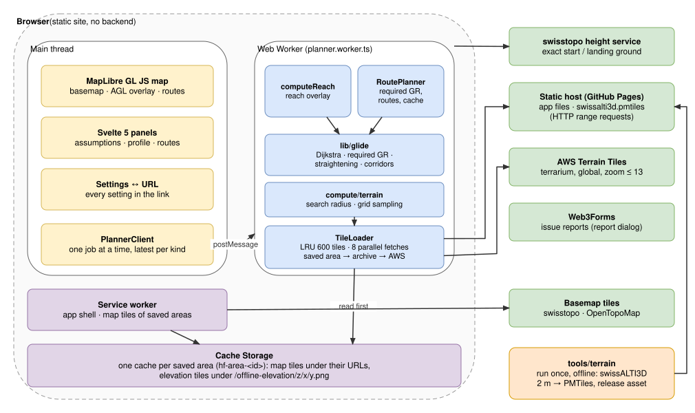
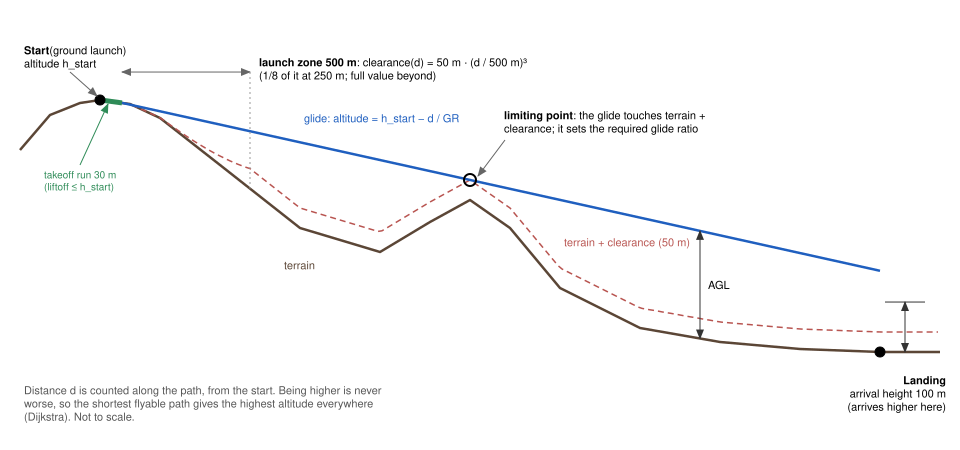
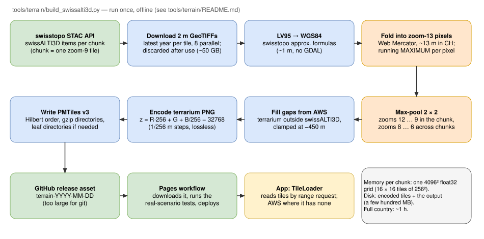
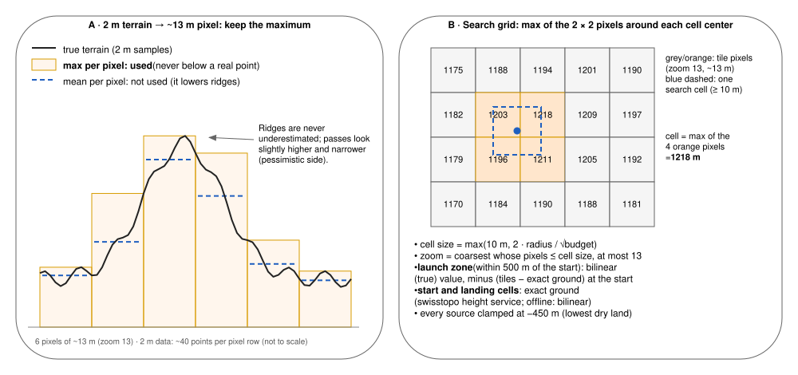
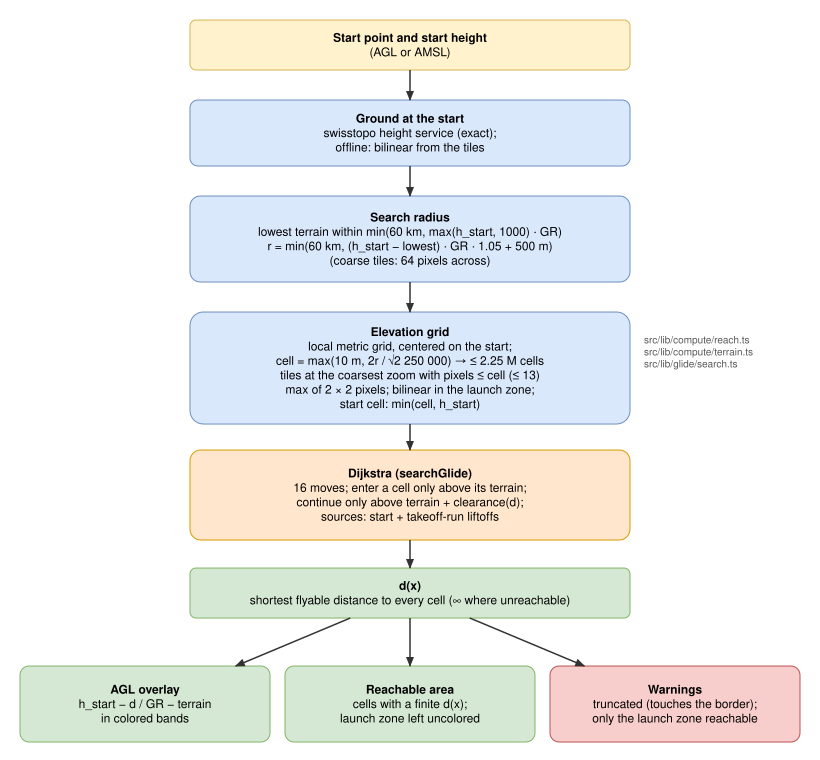
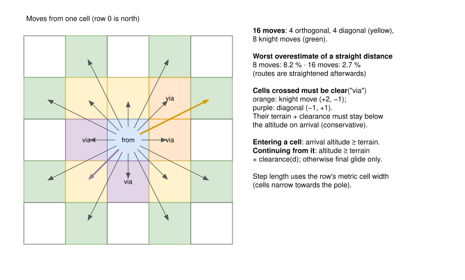
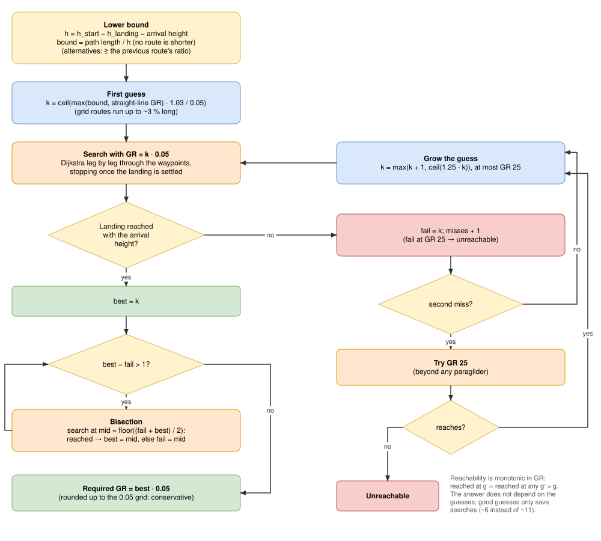
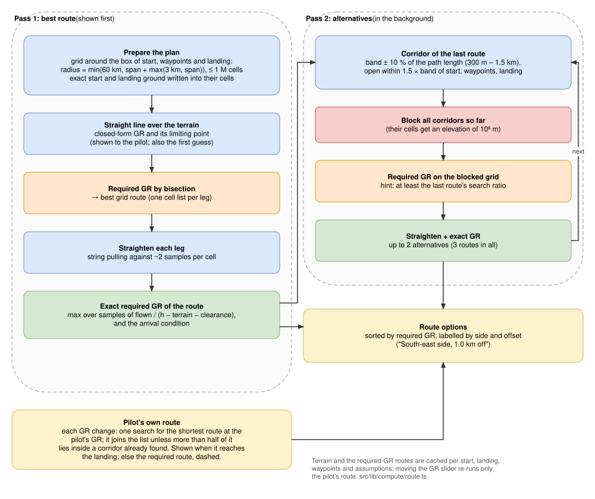
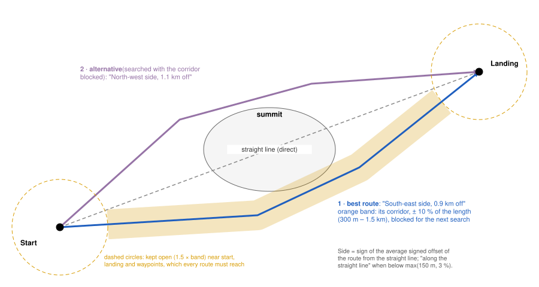

# Hike & Fly Planner — Methodology

This document explains **what the planner computes, how, and why**, step by step, so that
every number the app shows can be understood and checked by hand or with the tests. It
complements [`design.md`](design.md) (the compact design reference) and the
[architecture decision records](adr/README.md) (why each main choice was made).

Each section ends with **Verify**: where the step lives in the code, which tests pin it, and
how to check it independently. Code references point at the commit this document was written
against; line numbers may drift slightly.

Diagrams are `.drawio.svg` files in [`diagrams/`](diagrams): they render here and open for
editing in [draw.io](https://app.diagrams.net) or the VS Code draw.io extension.

**Contents**

1. [Overview](#1-overview)
2. [Symbols and units](#2-symbols-and-units)
3. [Flight model and assumptions](#3-flight-model-and-assumptions)
4. [Elevation data](#4-elevation-data)
5. [From tiles to a search grid (downsampling)](#5-from-tiles-to-a-search-grid-downsampling)
6. [Reachable area: constrained shortest path](#6-reachable-area-constrained-shortest-path)
7. [Required glide ratio](#7-required-glide-ratio)
8. [Routes: straightening, exact ratio, alternatives, waypoints](#8-routes)
9. [Display](#9-display)
10. [Accuracy and the direction of every error](#10-accuracy-and-the-direction-of-every-error)
11. [Validation](#11-validation)
12. [Performance](#12-performance)
13. [Offline](#13-offline)
14. [Limitations](#14-limitations)
15. [How to verify everything](#15-how-to-verify-everything)

---

## 1. Overview

The pilot picks a **start** (a takeoff, or a point in a thermal) and optionally a **landing**
and **waypoints**. The app answers three questions:

1. **Where can I glide to?** Every point reachable from the start with the pilot's glide
   ratio, colored by the height above ground (AGL) on arrival.
2. **What glide ratio do I need to reach the landing?** The smallest glide ratio that
   reaches it with the required arrival height, flying around terrain where needed.
3. **Which way?** Up to three distinct routes (e.g. either side of a mountain), each with
   its own required glide ratio, plus the straight line for comparison.

Everything runs in the browser: there is no server ([ADR-0001](adr/0001-static-client-side-app.md)).



| Part | Role | Code |
|---|---|---|
| Main thread | Map, panels, URL state; sends requests to the worker | `src/App.svelte`, `src/components/` |
| `PlannerClient` | Queues requests: one computation at a time, only the latest request of each kind is kept | [`client.ts`](../src/lib/compute/client.ts) |
| Web Worker | Loads terrain, runs the searches | [`planner.worker.ts`](../src/lib/compute/planner.worker.ts) |
| `lib/glide` | Pure algorithms, no DOM: Dijkstra, required ratio, route geometry | [`src/lib/glide/`](../src/lib/glide) |
| `lib/terrain` | Geodesy, Web Mercator tiles, terrarium decoding, grid sampling, tile loading | [`src/lib/terrain/`](../src/lib/terrain) |
| `tools/terrain` | Offline build of the Swiss elevation archive | [`build_swissalti3d.py`](../tools/terrain/build_swissalti3d.py) |

---

## 2. Symbols and units

All lengths are meters, all altitudes are meters above mean sea level (AMSL) unless marked AGL.

| Symbol | Meaning | Default |
|---|---|---|
| `GR` | Glide ratio: meters flown forward per meter of height lost, in still air | 5 |
| `h_start` | Start altitude AMSL (ground + start height when given AGL) | ground |
| `z(x)` | Terrain elevation of grid cell `x` | — |
| `d(x)` | Shortest distance from the start to cell `x` along a *flyable* path ([definition](#flyable-path)) | — |
| `a(x)` | Altitude over cell `x`: `h_start − d(x) / GR` | — |
| `AGL(x)` | `a(x) − z(x)` | — |
| `C` | Terrain clearance | 50 m |
| `L` | Launch zone length | 500 m |
| `c(d)` | Clearance required after flying `d` meters: `C · min(1, d / L)³` | — |
| `R` | Takeoff run length | 30 m |
| `H_arr` | Arrival height over the landing | 100 m |

Defaults are in [`settings.svelte.ts:20`](../src/lib/settings.svelte.ts#L20). Each one is shown
with an explanation in the Assumptions panel, and all of them are written into the URL, so a
shared link reproduces the plan exactly.

---

## 3. Flight model and assumptions



### 3.1 The glide

The glider loses height in proportion to the distance flown:

```
Δh = d / GR            altitude after d meters:  a = h_start − d / GR
```

This is a **fixed-ratio, still-air** model: no wind, no polar (the ratio does not depend on
speed), no lift or sink. Wind is shown as a warning, not hidden. The default `GR = 5` is
deliberately pessimistic: a light hike & fly wing glides about 7 at trim, and the margin
absorbs sinking air, headwind and pilot technique ([ADR-0012](adr/0012-conservative-defaults.md)).

### 3.2 The key observation: highest = shortest

Height lost depends only on the distance flown, and **being higher over a point is never
worse** (from higher up you can reach everything you could reach from lower down). So the
highest altitude achievable over any point comes from the **shortest flyable path** to it.

This turns the problem into a **single-source shortest-path search** with a constraint on
which cells may be entered ([ADR-0002](adr/0002-reachability-as-constrained-shortest-path.md)):

```
cell x may be entered     ⇔  h_start − d / GR ≥ z(x)                 (above the ground)
the glide may go on from x ⇔  h_start − d / GR ≥ z(x) + c(d)         (above the clearance)
```

A cell reached above the ground but below the clearance is a **final glide only**: you can
land there, but you can't continue. One search gives the whole overlay, the reachable area and
the best route to every cell.

#### Flyable path

A path is a sequence of cells `x₀, x₁, …, xₙ` where each step
is one of the 16 grid moves (§6.2). `x₀` is the start, or a liftoff cell of the takeoff run
(§3.5). Let:

- `D_k` be the distance at `x_k`: the length of the moves up to `x_k`, plus, after a
  liftoff, the starting distance `D₀ = (h_start − z(x₀) − 0.01) · GR` (`D₀ = 0` at the start);
- `a_k = h_start − D_k / GR` be the altitude over `x_k`;
- `c_k = c(D_k − D₀)` be the clearance at `x_k`, so the ramp counts from where the glide began.

The path is **flyable** when all of these hold:

| # | Condition | Applies to | Meaning |
|---|---|---|---|
| 1 | `a_k ≥ z(x_k)` | every cell `x₁ … xₙ` | never below the ground |
| 2 | `a_k ≥ z(x_k) + c_k` | every cell the glide continues from: `x₁ … xₙ₋₁` | the clearance holds wherever the glider flies on |
| 3 | `z(v) ≤ a_k − c_k` | the cells `v` crossed by the diagonal or knight move into `x_k` | cells flown over need the clearance too, checked at the lower arrival altitude `a_k` |
| 4 | `x₀` within `R` of the start and `z(x₀) < h_start` | a liftoff `x₀` only, on a ground launch | the run goes downhill, at most `R` |

The last cell `xₙ` needs only condition 1, which allows a final glide. Then:

```
d(x) = min { D_n : flyable paths ending at x }      (∞ when there is none)
```

Two points are deliberately *not* in this definition. The landing's arrival height is a
condition on the route, not on the path (§3.6, §7). The straightened routes of §8 are
straight segments rather than grid paths; they are checked against the same conditions 1–2
on samples every half cell.

The search of §6 computes this `d(x)` with one simplification: it keeps a single path per
cell, the shortest. The clearance ramp restarts at each liftoff, so near the takeoff a
*longer* path from a later liftoff can face less clearance than the shortest one, and could
go on where the shortest cannot. The search may miss such a path. That can only make `d(x)`
larger, never smaller, so the error is on the safe side and limited to the launch zone.

### 3.3 Terrain clearance `C = 50 m`

This is the minimum height above the terrain needed to fly over a cell and continue. It
covers sink and turbulence near slopes, plus elevation data errors. The data errors are small
next to 50 m, see §10.

### 3.4 Launch zone: the clearance ramp

From a ground launch the glider starts at AGL 0, so a constant clearance would make nothing
reachable. The clearance therefore **ramps from 0 at the start to `C` at `L`**, growing with
the cube of the distance ([ADR-0011](adr/0011-launch-zone-ramp-and-takeoff-run.md)):

```
c(d) = C · min(1, d / L)³
```

| `d` | 0 | 125 m | 250 m | 375 m | 500 m |
|---|---|---|---|---|---|
| `c(d)` (C = 50, L = 500) | 0 | 0.8 m | 6.3 m | 21.1 m | 50 m |

The cube keeps the requirement small while the pilot is still close to the slope. A flat
summit top or a shoulder just below the launch would block a linear ramp.

Code: [`clearanceAt`, geometry.ts:62](../src/lib/glide/geometry.ts#L62).

### 3.5 Takeoff run `R = 30 m`

On a ground launch the pilot runs before lifting off, and the first meters of a takeoff are
often flatter than the glide path. Every cell **within `R` of the start and not above it**
becomes an additional source of the search, *at its own ground level*:

```
liftoff cell x (|x − start| ≤ R, z(x) < h_start):
    d(x) = (h_start − z(x) − 0.01) · GR      so that   a(x) = h_start − d(x)/GR = z(x) + 0.01
```

Counting the height run down as "distance flown" keeps `a = h_start − d / GR` valid for the
whole search. The clearance ramp restarts from each liftoff (the search remembers where each
path's glide began). A start in the air (start height ≥ 1 m AGL) has no run.

Without the run, a gentle takeoff blocks everything. In the Amisbühl scenario, the required
ratio comes out as 6.5 instead of 5.0.

Code: [search.ts:126–150](../src/lib/glide/search.ts#L126), the 1 cm margin `LIFTOFF_MARGIN`
at [search.ts:82](../src/lib/glide/search.ts#L82), ground-launch test
[`groundLaunch`, terrain.ts:58](../src/lib/compute/terrain.ts#L58).

### 3.6 Arrival height `H_arr = 100 m`

The landing counts as reached only when the glider arrives at least `H_arr` above it, which
leaves height for a landing pattern. The landing cell itself needs no clearance.

### 3.7 Not modeled

Wind, glide polar, thermals and sink, airspace, lee-side turbulence, obstacles not in the
terrain model (cables, buildings, forest height: swissALTI3D is a *terrain* model). §14
lists the consequences.

> **Verify (§3)**
> - Tests: [`search.test.ts`](../src/lib/glide/search.test.ts): "reaches a circle of radius height × GR over flat ground", "computes AGL from the glide line", "reaches a cell below the clearance but does not continue from it", "ramps the clearance over the launch zone", "asks little clearance close to the launch", "takeoff run" group, "cannot take off from flat ground at AGL 0".
> - By hand: over flat ground at 1000 m below the start with `GR = 5`, the reachable disc has a radius of 5 km (minus the clearance band at its rim).

---

## 4. Elevation data

### 4.1 Sources and their order

| Source | Where | Resolution used | Code |
|---|---|---|---|
| Downloaded area (Cache Storage) | areas the pilot saved for offline use | same tiles as online | [loader.ts:125](../src/lib/terrain/loader.ts#L125) |
| swissALTI3D archive (`swissalti3d.pmtiles`) | Switzerland + border fill | zoom 6–13, ~13 m pixels | built by `tools/terrain` |
| AWS Terrain Tiles (terrarium) | worldwide fallback | capped at zoom 13 | [loader.ts:16](../src/lib/terrain/loader.ts#L16) |
| swisstopo height service | exact ground at start and landing, online, in CH | point query | [planner.worker.ts:23](../src/lib/compute/planner.worker.ts#L23) |

For each tile, the `TileLoader` tries a downloaded area first, then the archive (when the
zoom is in its range and the tile exists), then AWS. All sources stop at **zoom 13**, so
online and offline results agree and sources never mix within an area
([ADR-0006](adr/0006-terrarium-tiles-in-pmtiles.md)).

### 4.2 Terrarium encoding

Tiles are 256 × 256 PNGs. Each pixel encodes one elevation:

```
z = R · 256 + G + B / 256 − 32768        (1/256 m steps, range −32768 … +32767 m)
```

The format is lossless and browsers decode it natively; MapLibre reads it too. Every decoded
value is **clamped at −450 m**, the lowest dry land: AWS has sea depths and rare spikes
(down to −20 775 m in Lombardy), and the glider meets the surface.

Code: [`decodeTerrarium`, terrarium.ts:11](../src/lib/terrain/terrarium.ts#L11); encoder
[`encode_terrarium`, build_swissalti3d.py:100](../tools/terrain/build_swissalti3d.py#L100).

### 4.3 Building the Swiss archive



`tools/terrain/build_swissalti3d.py` runs once, offline ([ADR-0007](adr/0007-streaming-terrain-build-without-gdal.md)):

1. **List** the swissALTI3D 2 m GeoTIFFs per chunk via swisstopo's STAC API, keeping the
   latest year per 1 km tile. A chunk is one zoom-9 tile = 16 × 16 zoom-13 tiles = a
   4096² pixel grid in memory.
2. **Stream** each GeoTIFF (8 in parallel) and discard it after use. The whole country is
   ~50 GB of downloads, ~1 h.
3. **Reproject** each 2 m pixel center LV95 → WGS84 with swisstopo's approximate formulas
   (~1 m accuracy, far below the 13 m output pixel; no GDAL).
   [`lv95_to_wgs84`, :58](../tools/terrain/build_swissalti3d.py#L58)
4. **Fold** it into its zoom-13 Web Mercator pixel with a running **maximum**
   (`np.maximum.at`). [`Chunk.add`, :175](../tools/terrain/build_swissalti3d.py#L175)
5. **Max-pool** 2 × 2 for lower zooms: 12 … 9 inside the chunk, 8 … 6 across chunks.
   [`max_pool`, :190](../tools/terrain/build_swissalti3d.py#L190)
6. **Fill** pixels without swissALTI3D data (outside Switzerland) from AWS, clamped at
   −450 m, so border tiles are seamless. [`finish_tile`, :196](../tools/terrain/build_swissalti3d.py#L196)
7. **Encode** as terrarium PNG and **package** as one PMTiles v3 archive (Hilbert-ordered
   tiles, gzip directories), served by HTTP range requests from any static host.
   [`write_pmtiles`, :254](../tools/terrain/build_swissalti3d.py#L254)

The archive is published as a GitHub release asset and the Pages workflow deploys it with
the app ([`pages.yml`](../.github/workflows/pages.yml)).

> **Verify (§4)**
> - `cd tools/terrain && uv run python -m unittest` (no network): LV95 conversion, terrarium round trip, max pooling.
> - `uv run verify_pmtiles.py ../../public/terrain/swissalti3d.pmtiles` reads the archive with the official `pmtiles` reader.
> - Spot-check a pixel: decode a zoom-13 tile and compare with `https://api3.geo.admin.ch/rest/services/height?easting=…&northing=…&sr=2056` at a few points inside it. The tile value must be ≥ every point's height (it is the maximum), typically by a few meters on slopes.
> - `terrain.test.ts`: "decodes elevations", "clamps sea depths and spikes to the lowest dry land".

---

## 5. From tiles to a search grid (downsampling)



### 5.1 Why reduce 2 m data at all

A 15 km search radius at 2 m is 225 million cells, too many to search in a browser,
several times over. Meanwhile a few meters of elevation error matter little next to a 50 m
clearance. The data is therefore reduced twice: 2 m → ~13 m pixels in the archive (§4.3),
then tiles → search cells of ≥ 10 m in the browser.

### 5.2 Why the maximum, not the mean

Both reductions keep the **maximum** of the finer values ([ADR-0005](adr/0005-maximum-downsampling.md)):

- A cell is **never lower than any real point inside it**, so ridges and obstacles are never
  underestimated. That error would be on the unsafe side.
- The cost: passes look slightly higher and narrower, and slopes read a few meters high,
  which is slightly pessimistic.
- The mean would cut ridge tops and could route a glide *through* a ridge.

### 5.3 Where the maximum is wrong, and what is used instead

The maximum is *optimistic* for the **start**: a takeoff on a slope reads meters above the
real ground, so the slope just below looks flatter than it is and a ground launch fails.
Three exceptions handle this:

| Where | Elevation used | Code |
|---|---|---|
| Start and landing points | Exact ground from the swisstopo height service (offline: bilinear from tiles) | [`groundElevation`, terrain.ts:40](../src/lib/compute/terrain.ts#L40) |
| Start and landing **cells** | `min(cell, exact ground)`: start cell `min(cell, h_start)` | [reach.ts:66](../src/lib/compute/reach.ts#L66), [route.ts:286](../src/lib/compute/route.ts#L286) |
| Cells within the launch zone (`L` of the start) | **Bilinear** (true-ground estimate), lowered by `offset = bilinear(start) − exact ground(start)` | [`sampleGrid`, terrarium.ts:124](../src/lib/terrain/terrarium.ts#L124) |

The offset makes the tiles agree with the exact elevation at the start. Otherwise the cells
next to a ground launch read a few meters above it and nothing is reachable.

### 5.4 Grid geometry: local and metric

Web Mercator stretches distances by ~1.46× at Swiss latitudes, which would distort every
glide ratio. The search therefore runs on a **local equirectangular grid**
([ADR-0004](adr/0004-local-metric-grid.md)):

- square cells of `s` meters at the grid's center latitude, row 0 at the north;
- WGS84 meters-per-degree from the ellipsoid ([`metersPerDegree`, geo.ts:13](../src/lib/terrain/geo.ts#L13));
- the east–west cell width is recomputed per row ([`cellMetrics`, geo.ts:100](../src/lib/terrain/geo.ts#L100)),
  so distances stay metric even over a 120 km grid;
- the map is used only for display: the result is drawn back as an image with lat/lon corners.

### 5.5 Grid size, cell size and zoom

**Reach** grid, centered on the start ([`computeReach`, reach.ts:47](../src/lib/compute/reach.ts#L47)):

```
r_max    = min(60 km, max(h_start, 1000) · GR)
lowest   = lowest terrain within r_max     (coarse tiles: zoom with ~64 pixels across r_max)
radius r = min(60 km, (h_start − lowest) · GR · 1.05 + 500 m)
```

**Route** grid, centered on the box of start, waypoints and landing ([route.ts:269](../src/lib/compute/route.ts#L269)):

```
span     = half the diagonal of the box
radius r = min(60 km, span + max(3 km, span))     (room for detours on every side)
```

Both then ([`loadElevationGrid`, terrain.ts:82](../src/lib/compute/terrain.ts#L82)):

```
cell size s = max(10 m, 2r / √budget)       budget: reach 2 250 000, route 1 000 000 cells
zoom        = coarsest zoom whose pixel size ≤ s, at most 13     (geo.ts:46)
cell value  = max of the 2 × 2 tile pixels around the cell center (exceptions: §5.3)
```

The route grid has the smaller budget because it is searched ~6–10 times per plan
([ADR-0013](adr/0013-cell-budgets.md)).

**Worked example**: reach from Niesen (`h_start` = 2258.4 m, ground launch, GR 5, Lake Thun
at ~558 m as the lowest terrain):

```
r = (2258.4 − 558) · 5 · 1.05 + 500 = 9 427 m
s = max(10, 2 · 9 427 / 1 500)      = 12.57 m       → 1 501 × 1 501 ≈ 2.25 M cells
pixel size at 46.6° N: zoom 12 = 26.3 m, zoom 13 = 13.1 m  → zoom 13 (the cap)
```

Each search cell (12.6 m) then takes the maximum of the four ~13 m pixels around its center.

> **Verify (§5)**
> - `terrain.test.ts`: "picks a zoom with pixels no larger than the cell", "builds a grid centered on the start with square metric cells", "samples bilinearly between pixel centers", "takes the max away from the start and the true value near it", "lowers only the values near the start by the offset".
> - The app's Assumptions panel shows the cell size and elevation source of every result; the issue report includes them as well.

---

## 6. Reachable area: constrained shortest path



### 6.1 The search

[`searchGlide`, search.ts:93](../src/lib/glide/search.ts#L93) is Dijkstra's algorithm on the
grid, with a binary min-heap ([`heap.ts`](../src/lib/glide/heap.ts)):

```
d(start) = 0;  d(liftoff cells) = (h_start − z − 0.01) · GR       (§3.5)
pop the cell x with the smallest d
    a = h_start − d / GR
    if a < z(x) + c(d − glideStart(x)):  final glide only, don't expand
    for each of the 16 moves x → y with step length ℓ:
        d' = d + ℓ;   a' = h_start − d' / GR
        skip if d' ≥ d(y)                               (not shorter)
        skip if a' < z(y)                               (would hit the ground)
        skip if a cell crossed on the way has z > a' − c(d' − glideStart)   (§6.2)
        d(y) = d';  predecessor(y) = x;  push y
```

Distances are stored as `Float32` and every new distance is rounded the same way before the
comparisons. Otherwise stale heap entries would be misdetected. A start whose float32 ground
rounds up above `h_start` is accepted (test "launches from a summit whose elevation float32
rounds up").

### 6.2 Sixteen moves and the cells they cross



With only 8 neighbours, a straight line in a direction between an axis and a diagonal is
approximated by a zigzag up to **8.2 %** longer (`1 / cos 22.5°`). That error inflates every
glide ratio. Adding the 8 knight moves bounds it to **2.7 %**
([ADR-0003](adr/0003-sixteen-neighbour-grid-search.md)).

A diagonal or knight move passes over two intermediate cells ("via"). Both must be clear by
the clearance **at the arrival altitude** `a'`, which is lower than the actual altitude over
them, so the check is conservative. For a diagonal this also prevents slipping through the
zero-width gap between two blocked cells (test "does not slip diagonally between two blocked
cells").

Step lengths use the metric width of the departure row: `ℓ = hypot(dc · w_row, dr · s)`.

### 6.3 Outputs

| Output | Formula | Code |
|---|---|---|
| Altitude | `a(x) = h_start − d(x) / GR` | |
| AGL | `a(x) − z(x)`, NaN where unreachable | [`computeAgl`, search.ts:199](../src/lib/glide/search.ts#L199) |
| Reachable area | cells with a finite `d(x)` | |
| Route to any cell | follow `predecessor` back to the start | [`traceRoute`, search.ts:211](../src/lib/glide/search.ts#L211) |
| `truncated` | a reachable cell touches the grid border: the area may be cut off (60 km cap) | [search.ts:156](../src/lib/glide/search.ts#L156) |
| "only the launch zone" warning | no reachable cell with `d ≥ L` | [reach.ts:82](../src/lib/compute/reach.ts#L82) |

> **Verify (§6)**
> - `search.test.ts`: synthetic terrains (flat plane, cone, wall, wall with a gap, closed wall); every rule above has its own test.
> - By hand for any colored cell: `AGL = h_start − d / GR − z`. The profile chart of a route shows `d`, the altitude and the terrain along it.
> - Real terrain: `scenarios.test.ts` checks that the AGL over each landing in the reach overlay is never above the straight-line bound `h_start − geodesic / GR − z_landing`. No path is shorter than the straight line.

---

## 7. Required glide ratio



### 7.1 Monotonicity

The route depends on the glide ratio: a worse glider loses height faster, so ridges become
walls and it has to go around. Reachability is **monotonic** in the glide ratio. If the
landing is reached at `g`, it is reached at every `g' > g`, because the glider is higher over
every cell. So the smallest sufficient ratio can be found by searching over ratios
([ADR-0008](adr/0008-required-ratio-by-bracketing-and-bisection.md)).

### 7.2 The procedure

[`findRequiredGlideRatio`, required.ts:74](../src/lib/glide/required.ts#L74). Ratios are
`k · 0.05`; `fail` is the largest `k` known to fail and `best` the smallest known to reach.

1. **Lower bound.** `h = h_start − z_landing − H_arr`. If `h ≤ 0`: unreachable. No route is
   shorter than the straight line (through the waypoints, if any), so
   `bound = path length / h`, and `fail = ceil(bound / 0.05) − 1`. For alternatives,
   the ratio needed by the previous, less blocked grid is also a lower bound (`atLeast`).
2. **First guess.** `k = ceil(max(bound, straight-line ratio over the terrain) · 1.03 / 0.05)`.
   The 1.03 covers the grid's distance overestimate (§6.2).
3. **Search** with `GR = k · 0.05` ([`arriveWith`, required.ts:28](../src/lib/glide/required.ts#L28)):
   Dijkstra leg by leg (§8.5), stopping as soon as the landing is settled. Reached if
   `h_start − d(landing) / GR − z_landing ≥ H_arr`.
4. **If it fails**: `fail = k`, grow `k = max(k + 1, ceil(1.25 k))`. After the **second** miss,
   try `GR = 25` (beyond any paraglider). If even that fails, the landing is unreachable,
   known after 3 searches.
5. **If it reaches**: `best = k`, then **bisect** between `fail` and `best` until they are
   adjacent.
6. Result: `best · 0.05`, i.e. rounded **up** to 0.05 (conservative).

The result doesn't depend on the guesses (monotonicity); good guesses only save searches:
~6 instead of ~11 on the real scenarios, and costly searches at high ratios are avoided
(−65 % search time).

**Worked example** (Niesen → Frutigen, straight line clear; `h = 2258.4 − 779.2 − 100 = 1379.2 m`,
distance 6 516 m):

```
bound = 6 516 / 1 379.2 = 4.725  → fail = ceil(94.5) − 1 = 94        (4.70 fails for sure)
guess = ceil(max(4.725, 4.733) · 1.03 / 0.05) = ceil(97.5) = 98     → GR 4.90: reached, best = 98
mid 96 (4.80): reached → best = 96;   mid 95 (4.75): reached → best = 95;   95 − 94 = 1: stop
grid result: 4.75 (3 searches). The route is then straightened and its exact ratio computed: 4.728 (§8.2)
```

The UI shows ratios rounded **up** to 0.1 ([RouteSummary.svelte:26](../src/components/RouteSummary.svelte#L26)).

> **Verify (§7)**
> - `required.test.ts`: "equals the straight-line glide ratio over flat ground", "needs a better glide ratio to fly around a wall", "picks the detour only when it is needed", "finds the same ratio whatever the guesses", "needs fewer searches with a good estimate", "returns null when even the largest ratio does not reach", "returns null when the landing is above the start / is enclosed".
> - By hand: when the straight line is clear and the arrival height is the limit, the result equals `distance / (h_start − z_landing − H_arr)`, minus the takeoff run's effect.

---

## 8. Routes



[`RoutePlanner`, route.ts:130](../src/lib/compute/route.ts#L130) runs in two passes. The best
route is shown first, and alternatives follow in the background.

### 8.1 Straightening

A grid route follows cell centers and zigzags. [`straightenRoute`, geometry.ts:132](../src/lib/glide/geometry.ts#L132)
replaces it by straight segments wherever they are flyable ("string pulling"). From each
vertex, it jumps to the farthest later cell of the route that can be reached in a straight,
flyable line, checked against samples every half cell. The result is never longer than the
grid route, so it stays flyable at the same ratio. This removes most of the grid's distance
overestimate: paths bending around obstacle corners stay within ~3 %.

Samples take the terrain of their cell (the maximum, §5.2), except within the launch zone,
where they interpolate between cell centers, capped at their own cell. With a single value
per cell, the steep ground just below a summit reads meters too high, and right after the
start a few meters decide the ratio. See [`sampleSegment`, geometry.ts:91](../src/lib/glide/geometry.ts#L91).

### 8.2 Exact required ratio of a fixed route (closed form)

For a fixed line, the smallest ratio follows directly from its samples
([ADR-0009](adr/0009-straightened-routes-with-exact-ratio.md), [`glideLimit`, geometry.ts:193](../src/lib/glide/geometry.ts#L193)). With the liftoff at
distance `d₀` and altitude `a₀` (the start, or the end of the takeoff run):

```
for each sample i (except start, liftoff and landing cells):
    flown_i = d_i − d₀
    room_i  = a₀ − z_i − c(flown_i)          ≤ 0  →  impossible at any ratio (blocked)
    GR_i    = flown_i / room_i
arrival:    GR_arr = (length − d₀) / (a₀ − z_landing − H_arr)
required GR = max(GR_arr, max_i GR_i)
```

The sample setting the maximum is the **limiting point**: the glide line touches the
clearance line there (diagram §3). Arrival heights for any ratio then follow instantly
without a search. Each route option shows this exact value, which can be slightly *below* the
grid search ratio because straightening shortened the route.

### 8.3 The straight line

The direct line from start to landing is always evaluated with the same closed form
([`straightLine`, geometry.ts:237](../src/lib/glide/geometry.ts#L237)) and shown as *clear*,
*raised by the ground at a named point*, or *blocked*. On a ground launch it lifts off at the
best sample within the takeoff run along the line (at the ground there, never above the
start). With waypoints it stays the direct start → landing line, for comparison.

### 8.4 Alternative routes: corridor blocking



To find routes on other sides of a mountain ([ADR-0010](adr/0010-alternatives-by-corridor-blocking.md)):

1. Mark the **corridor** of the last route found: all cells within `w` of it, where
   `w = clamp(10 % of the path length, 300 m, 1.5 km)`. Within `1.5 w` of the start, the
   landing and each waypoint the corridor stays open, because every route must pass there
   ([`corridorMask`, geometry.ts:269](../src/lib/glide/geometry.ts#L269)).
2. **Block** all corridors so far (their elevation becomes 10⁶ m) and run the required-ratio
   search again, with the previous ratio as a lower bound (`atLeast`: a more blocked grid
   never needs less).
3. Straighten, compute the exact ratio. Repeat for up to 2 alternatives (3 routes).

The **pilot's own route** (the shortest path at the pilot's ratio, one search per ratio
change) joins the list when more than half of it lies outside the corridors already found
([`shareInside`, geometry.ts:292](../src/lib/glide/geometry.ts#L292)); otherwise the matching
route is marked as the pilot's. Routes are sorted by required ratio.

**Labels** ([`routeSide`, route.ts:344](../src/lib/compute/route.ts#L344)): the average
signed offset of the route's samples from the straight line gives the side (as a compass
direction of the normal) and the distance: "South-east side, 1.0 km off". Below
`max(150 m, 3 % of the distance)` the route is "Along the straight line".

### 8.5 Waypoints

Being higher at a waypoint is never worse, so the search chains **one leg per waypoint**
([`arriveWith`, required.ts:28](../src/lib/glide/required.ts#L28)): each leg starts at its
waypoint with the distance flown so far (`startDistance`). Only the first leg has the takeoff
run and the launch zone, and waypoints must be flown over with the full clearance. Legs are
straightened separately so that no shortcut skips a waypoint
([`straightenLegs`, geometry.ts:218](../src/lib/glide/geometry.ts#L218)). The lower bound of
§7 uses the polyline through the waypoints. The reach overlay ignores waypoints. In links:
`wp=lat,lng;lat,lng`.

### 8.6 Caching

Terrain, the straight line and the required-ratio routes depend on start, landing, waypoints
and assumptions, **not** on the pilot's glide ratio. They are cached for the last plan, so
moving the GR slider re-runs only the pilot's route ([route.ts:171](../src/lib/compute/route.ts#L171)).

> **Verify (§8)**
> - `geometry.test.ts`: "turns a clear grid route into one straight segment", "bends only at obstacle corners", the launch-zone sampling tests, "takeoff run", `requiredGlideRatioFor` and `straightLine` groups, "covers the route away from its ends".
> - `required.test.ts`, "through waypoints": order, imposed detour, clearance over waypoints.
> - By hand: the profile chart shows terrain and glide line along a route. The required ratio is the steepest line from the liftoff that stays above terrain + clearance and reaches the landing `H_arr` high.
> - Independently: `scenarios.test.ts` recomputes each best route's ratio on the swisstopo **2 m** profile service along the route's vertices (see §11).

---

## 9. Display

- **AGL bands** ([`aglBands`, agl.ts:40](../src/lib/render/agl.ts#L40)):
  `0 – C` "final glide only", then `C`, 250, 500, 750, 1000, 1500, 2000 m and above.
  Red → green (ColorBrewer RdYlGn) by default. Viridis is available as a colour-blind
  scheme (monotonic lightness), stored per browser.
- The launch zone (cells reached with `d < L`) is left uncolored: AGL there is dominated by
  the slope just below the takeoff.
- The pilot's route is drawn solid when it reaches the landing. Otherwise the required
  route is drawn dashed. The profile uses the same colors as the overlay.

---

## 10. Accuracy and the direction of every error

Each approximation is chosen to err on the **safe side**: towards a higher required glide
ratio, a smaller reachable area and a lower AGL.

| Source of error | Size | Direction | Section |
|---|---|---|---|
| Maximum per 13 m pixel and per search cell | meters on slopes; most where steep | terrain higher → pessimistic | §5.2 |
| Grid distance (16 moves), before straightening | ≤ 2.7 % open air, ≤ ~5 % around corners | longer → pessimistic | §6.2 |
| Straightened routes around corners | ≤ ~3 % | longer → pessimistic | §8.1 |
| Via cells checked at the arrival altitude | one step of height | pessimistic | §6.2 |
| Ratio rounded up to 0.05 (search), 0.1 (display) | ≤ 0.1 | pessimistic | §7.2 |
| LV95 ↔ WGS84 approximate formulas | ~1 m horizontally | negligible | §4.3 |
| Launch zone: bilinear instead of maximum | sub-pixel | *slightly optimistic*, bounded by the cell max | §5.3 |
| Start/landing exact elevation | exact online; offline the tiles read high | offline: start higher (optimistic), landing higher (pessimistic) | §5.3 |
| Terrain model without trees, buildings, cables | up to tens of meters | **optimistic**: covered by the clearance | §3.7 |
| Still air, fixed ratio | unbounded | covered by the pessimistic default GR | §3.1 |

The largest observed gap to the 2 m reference comes from the **13 m pixels on steep
ground**, not from the cell size: on the straight lines of Amisbühl (+12.8 %) and Brunni
(+8.4 %), the line skims a steep slope where the maximum of a 13 m pixel stands well above
the 2 m profile. Halving the cell size changes results by ≤ 1 percentage point
([ADR-0013](adr/0013-cell-budgets.md)).

---

## 11. Validation

[`scenarios.test.ts`](../src/lib/compute/scenarios.test.ts) runs nine real hike & fly
scenarios (takeoffs and landings from OpenStreetMap) on the swissALTI3D archive and compares
them with **independent references**:

- start and landing ground: the swisstopo height service;
- straight distance: the WGS84 geodesic (Vincenty), within 1 m;
- each best route's required ratio, **recomputed on the swisstopo 2 m profile service** along
  the route's vertices, from its liftoff.

Assertions: the app's ratio is **≥ 0.99 ×** the 2 m value (it may be slightly lower only where
the launch zone interpolates) and **≤ 1.07 ×** it. The straight line is ≥ 0.99 × its 2 m value.
The reach AGL over the landing never exceeds the straight-line bound.

| Scenario | 2 m reference | App (best route) | Difference |
|---|---|---|---|
| Niesen → Frutigen (straight, arrival-limited) | 4.733 | 4.728 | −0.1 % |
| Niederhorn → Lehn (around a spur) | 3.959 | 4.042 | +2.1 % |
| First → Grindelwald Grund (straight) | 4.285 | 4.286 | 0.0 % |
| First → Interlaken (chain blocks the line) | 12.744 | 12.899 | +1.2 % |
| Thermal 3200 m over First → Interlaken | 6.478 | 6.599 | +1.9 % |
| Brunnihütte → Engelberg (around the slope) | 4.070 | 4.133 | +1.5 % |
| Amisbühl → Interlaken (gentle takeoff) | 5.016 | 5.012 | −0.1 % |
| Männlichen → Wilderswil (rounded summit) | 4.606 | 4.642 | +0.8 % |
| Brienzer Rothorn → Hofstetten (flat edge, then steep) | 2.483 | 2.485 | +0.1 % |

The tests also pin every route's side, ratio and length, so any change in results is noticed
in review. The GitHub Pages workflow runs them on every push, after downloading the archive.

---

## 12. Performance

- One Dijkstra over the reach grid (≤ 2.25 M cells) per reach request.
- Route planning: ~6 searches for the required ratio (each stopping at the landing, on ≤ 1 M
  cells), then one more required-ratio search per alternative, in the background. Measured on desktop Node: best route for a
  9.7 km plan 1.2 s, 15.4 km 1.5 s ([ADR-0013](adr/0013-cell-budgets.md)).
- The worker runs one computation at a time. While one runs, only the latest request of each
  kind is kept, so dragging a slider doesn't queue up stale work ([`PlannerClient`](../src/lib/compute/client.ts)).
- Tiles: an LRU cache of 600 decoded tiles, 8 concurrent fetches.
- The Assumptions panel shows terrain and search times for every result.

---

## 13. Offline

([ADR-0014](adr/0014-offline-with-service-worker-and-cache-storage.md))

- **App shell**: a hand-written service worker precaches the built files (a Vite plugin
  fills in the file list and a version per build). Installable as a PWA.
- **Saved areas** ("Download this area"): one Cache Storage cache per area
  ([`areas.ts`](../src/lib/offline/areas.ts)):
  - map and slope tiles for zooms 8 … the chosen detail (13–16), under their real URLs,
    served by the service worker;
  - elevation zooms 10–13 over the area + 5 km, and zooms 6–9 for 60 km around it, because
    the reach search looks for the lowest terrain far out (§5.5). They are stored under
    `/offline-elevation/z/x/y.png` and read **directly by the worker**, so elevation works
    offline even without the service worker.
- Because all sources stop at zoom 13, offline results equal online results, except for the
  start and landing ground (tiles instead of the height service, §10).

---

## 14. Limitations

- **Still air, fixed ratio.** Wind, polar and sink are covered only by the pessimistic
  default ratio. A headwind of a third of the trim speed cuts the ground glide ratio by a third.
- **Terrain model only.** Trees, buildings, cables and avalanche barriers are not in
  swissALTI3D: the clearance must cover them.
- **13 m pixels.** Narrow gaps and gullies narrower than ~2 pixels disappear (they read at
  their rim's height). Steep slopes read high.
- **No airspace, no lee-side or valley-wind warnings.**
- **Search extent** is capped at 60 km radius. A `truncated` result says so.
- Outside Switzerland, AWS Terrain Tiles are coarser (~10–30 m in the Alps) and of mixed
  origin.

---

## 15. How to verify everything

```sh
npm ci
npm run check                     # types
npm test                          # unit tests; the scenarios run only with the archive:

gh release download terrain-2026-10-27 --pattern swissalti3d.pmtiles --dir public/terrain
npm test                          # now also the nine real scenarios (§11)

cd tools/terrain
uv run python -m unittest         # terrain build: LV95, terrarium, max pooling
uv run verify_pmtiles.py ../../public/terrain/swissalti3d.pmtiles
```

Independent checks without the code:

| What | How |
|---|---|
| Ground at a point | `https://api3.geo.admin.ch/rest/services/height?easting=E&northing=N&sr=2056` (LV95) |
| Terrain profile along a route | `https://api3.geo.admin.ch/rest/services/profile.json?geom={"type":"LineString","coordinates":[[E,N],…]}&sr=2056` |
| A route's required ratio | from the profile: `max(flown / (a₀ − z − c(flown)))` and `(length − d₀) / (a₀ − z_landing − H_arr)` (§8.2) |
| An overlay cell | `AGL = h_start − d / GR − z`; the profile chart shows `d` and the altitude |
| What a shared plan used | the link holds every setting; "Report an issue" lists routes, ratios, grids, elevation source and app version |
